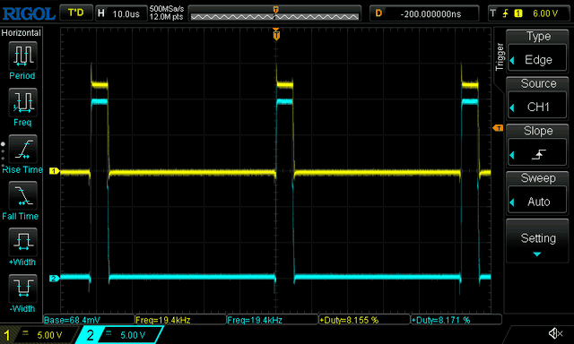

# 02. ハーフブリッジの動作確認

[02. ハーフブリッジ](02-half-bridge.md) の回路を、実際に組んで確認した手順と記録です。回路の仕組み、接続表、部品値、ファームウェアのコマンドは、設計の資料 ([02-half-bridge.md](02-half-bridge.md)) にあります。

## 1. 進め方

部品を少しずつ増やして、3つの段階で組みます。各段階の配線図の後に、その段階で確認したことを記録します (備忘録)。前の段階で問題があれば、次に進みません。部品を壊した失敗の記録は、最後の 5 節にまとめています。

| 段階 | 内容 | 配線 | 電源の電流制限 |
|---|---|---|---|
| 1 | ロジックだけ (MOSFET なし) | 2 節。VS は GND に直結 | 0.1A |
| 2 | MOSFET を実装、負荷は 10kΩ | 3 節。VS は中点へ | 0.5A |
| 3 | モーター (一方向) | 3 節の Load にモーター | 回り始めの電流から決める (4 節) |

電源は、入れるときは USB (5V) → 12V、切るときは `o` (全OFF) → 12V → USB (5V) の順にします ([設計の資料](02-half-bridge.md) の 5.4 節)。

配線図の読み方 (共通):

- IRS2003 を上、ATtiny1604 を下に並べています。ATtiny1604 は、1〜7番ピンの側 (PA4、PA5) を使います。図中の数字はピン番号です。
- `*` は接続点です。**線が交差していても `*` がなければ、接続していません。** (例: PA4 の横線と PA5 の縦線、HO の線と C_boot の縦線)
- `+12V`、`GND`、`+5V` のラベルは、同じ名前のどうしが接続されている、という意味です (線では結んでいません)。
- 左の `[10k]` は、HIN 側がプルダウン (GND へ)、/LIN 側がプルアップ (+5V へ) です。
- `D_boot` は、+12V から VB へ向かうダイオードです (`v` が電流の向き、`-----` の帯が K = カソード)。
- `(scope)` は、何もつながず、オシロで観察する端子です。
- ATtiny1604 の GND (14番ピン) と PA0 (10番ピン、UPDI 用) は、図では省略しています。

## 2. 段階 1: ロジックだけ (MOSFET なし)

```
                                                               +12V
                                                                 |
                                     GND                         |
                                      |                          v  D_boot
           GND       C_vcc 10u+0.1u  ---                       -----
            |                        ---        IRS2003S         |
          [10k]                       |     +------\_/------+    |
            |                    +12V *-----| 1 VCC    VB 8 |----*
  +---------*-------------------------------| 2 HIN    HO 7 |----|-------> HO (scope)
  |  +---------------------------*----------| 3 /LIN   VS 6 |----|--+
  |  |                           |   GND ---| 4 COM    LO 5 |-+  |  |  <- stage 1: VS = GND
  |  |                         [10k]        +---------------+ |  |  |
  |  |                           |                            | --- |
  |  |            ATtiny1604    +5V                           | --- | C_boot 1u
  |  |        +-------\_/-------+                             |  +--*
  |  |  +5V --| 1 VCC    GND 14 |                             |     |
  +--|--------| 2 PA4    PA3 13 |                             |    GND
     +--------| 3 PA5    PA2 12 |                             |
              | 4 PA6    PA1 11 |                             +-----------> LO (scope)
              | 5 PA7    PA0 10 |
              | 6 PB3    PB0  9 |
              | 7 PB2    PB1  8 |
              +-----------------+
```

- **VS は GND に直結します。** C_boot は VS が GND に下がっている間にだけ充電されるため ([設計の資料](02-half-bridge.md) の 3.5 節)、こうしないと HO が動きません。
- VS が GND なので、HIN、/LIN、HO、LO は、すべて GND 基準でオシロに測れます。
- C_vcc と C_boot は、IRS2003 のそばに置きます。

### 1-1. 通電前の確認

**目的**: 配線の間違いと、電源の短絡がないことを確かめる。接続表 ([設計の資料](02-half-bridge.md) の 5.2 節) との照合、GND が共通になっていること、+12V と GND の間が短絡していないこと (テスター) を見る。

**記録**

- やったこと: 2 節の段階 1 の配線を組んだ (MOSFET なし、VS は GND に直結)。電源を入れる前に、テスターで確認した
- 確認したこと:
  - +12V と GND の間が短絡していない
  - いくつかの箇所で、GND が来ている (導通がある)
- 結果: 問題なし。1-2 に進む

### 1-2. 書き込みと、HIN・/LIN の波形

**目的**: ファームウェアが動き、ATtiny1604 の PA4 (HIN) と PA5 (/LIN) に、想定どおりの信号が出ていることを確かめる。

**記録**

- やったこと: `02-half-bridge` を書き込み、USB (5V) → 12V の順に電源を入れた。何もキーを押さない状態 (全OFF) で、IRS2003 の各ピンの電圧をテスターで測った
- 確認したこと:
  - 最初は、全OFF なのに HO が約 12V、LO が約 0.9V だった
  - 配線を確かめると、**COM (4番ピン) の線が抜けていた**。つなぐと LO は 0V になったが、HO は約 12V のままだった
  - `h` (高側パルス) を押すと、HO は 0V になった
  - その後、1日以上電源を切ってから入れ直したときも、12V を切って 10 秒以上待ってから入れ直したとき (3回) も、HO は 0V で始まった
- 結果と気づいたこと:
  - COM が抜けていると、IC の電流が本来通らない道を通って戻り、高側のラッチが誤って ON になったと考えられる (推測)
  - 高側のラッチは、HIN が変化したときのパルスでしか切り替わらないので、COM をつないだ後も、HIN が変化するまで ON のまま残った。`h` で HIN が 0 → 1 → 0 と変化して、OFF にそろった
  - 正しく配線していれば、電源を入れた直後は OFF で始まることが多いが、データシートで保証されてはいない。対策として、低側をONにする直前に HIN に短いパルスを出して、高側を OFF にそろえる処理をファームウェアに入れた ([設計の資料](02-half-bridge.md) の 6.1 節)

この後、COM の線をつなぎ直すときに誤って 12V につなぎ、IRS2003 と ATtiny1604 を壊した (5 節)。

**記録 (部品を交換したあと)**

- やったこと: IRS2003 と ATtiny1604 を、予備の部品と新しい変換基板に交換した。隣り合うピンどうしが導通していないことを、テスターで確かめた。UPDI で接続できなかったが、FT232RQ の TXD と RXD のケーブルが逆だったのを直すと、シグネチャ (`0x1e9425`) が読めた。高側のラッチを OFF にそろえる対策 ([設計の資料](02-half-bridge.md) の 6.1 節) を入れた `02-half-bridge` を書き込み、USB (5V) → 12V の順に電源を入れた
- 確認したこと: 何もキーを押さない状態 (全OFF) で、IRS2003 の各ピンの電圧をテスターで測った

  | ピン | 名前 | 電圧 |
  |---|---|---|
  | 1 | VCC | 約 12V |
  | 2 | HIN | 0V |
  | 3 | /LIN | 約 5V |
  | 4 | COM | 0V |
  | 5 | LO | 0V |
  | 6 | VS | 0V |
  | 7 | HO | 0V |
  | 8 | VB | 約 11.6〜11.9V |

- 結果: すべて期待どおり。1-3 に進む

### 1-3. 静的テストでの HO・LO

**目的**: IRS2003 が入力どおりに HO と LO を出すことを確かめる。電源を入れた直後の消費電流 (数mA 以下のはず) も見る。

期待する変化 (`s` コマンドの静的テスト。`s` を押した時点を 0秒 とする):

| 時間 | 状態 | HIN | /LIN | HO | LO |
|---|---|---|---|---|---|
| 0〜1秒 | 全OFF | 0 | 1 | 0V | 0V |
| 1〜3秒 | 低側のみON | 0 | 0 | 0V | 約12V |
| 3〜4秒 | 全OFF | 0 | 1 | 0V | 0V |
| 4〜6秒 | 低側5ms → 全OFF → 高側10ms を20回 | 10msだけ1 | 5msだけ0 | 10ms幅で約11.5V | 5ms幅で約12V |
| 6〜7秒 | 全OFF | 0 | 1 | 0V | 0V |

**記録 (`h` の高側パルス)**

- やったこと: オシロの CH1 に HO (7番)、CH2 に LO (5番) をつなぎ、時間軸 2ms/div、縦軸 5V/div、トリガは CH1 (HO) の立ち上がり (シングル) にして、`h` を押した

  | | プローブ | 色 | 縦軸 |
  |---|---|---|---|
  | CH1 | HO (IRS2003 の 7番) | 黄 | 5V/div |
  | CH2 | LO (IRS2003 の 5番) | 水色 | 5V/div |

  時間軸 2ms/div、トリガは CH1 の立ち上がり、5.9V

  

- 確認したこと: 波形のデータから計算した値と、オシロの測定値

  | 項目 | HO (CH1) | LO (CH2) | 期待 |
  |---|---|---|---|
  | パルスの幅 | 10.04ms | 4.04ms | HO 約10ms、LO 4〜5ms |
  | High のときの電圧 (Vtop) | 11.67V | 12.3V | HO 約11.5V、LO 約12V |
  | 最大値 (Vmax) | 17.2V | 16.0V | ― |

- 結果と気づいたこと:
  - 低側 → 全OFF → 高側の順に、期待どおりの時間と電圧で動いた。LO が 5ms ではなく 4.04ms なのは、時刻を 1ms の割り込みで数えているため ([設計の資料](02-half-bridge.md) の 6.2 節。4〜5ms の間になる)
  - 切り替わりの瞬間に、細いとげ (最大 16〜17V) が出ている。オシロの自動測定 (CH1 の +Width) は、このとげのためにエラーになったので、パルスの幅は波形のデータから、とげを無視して計算した ([00-oscilloscope.md](00-oscilloscope.md) の 4 節)。時間軸を拡大すると、とげは数 ns の振動だった (下の拡大の記録と 1-4)。原因 (プローブの GND の線の長さか、実際の振動か) は未確認
  - `s` (静的テストの全体) は、下の記録で確認した

**記録 (`h` の拡大: LO が上がる直前の HO のパルス)**

- やったこと: 上の `h` の記録の、LO が上がる直前を拡大した。時間軸 5µs/div、トリガは CH2 (LO) の立ち上がり (シングル)、トリガの位置を画面の右寄りにして、`h` を押し、高側のラッチを OFF にそろえる対策 ([設計の資料](02-half-bridge.md) の 6.1 節) のパルスを見た

  | | プローブ | 色 | 縦軸 |
  |---|---|---|---|
  | CH1 | HO (IRS2003 の 7番) | 黄 | 5V/div |
  | CH2 | LO (IRS2003 の 5番) | 水色 | 5V/div |

  時間軸 5µs/div、トリガは CH2 の立ち上がり、6V

  

- 確認したこと (波形のデータから、2ns ごと):

  | 項目 | 測定値 | 期待 |
  |---|---|---|
  | HO の短いパルスの幅 | 1.53µs | 約 1.5µs (HIN の 2µs − ターンオンの遅れ 680ns + ターンオフの遅れ 150ns) |
  | HO が下がってから LO が上がるまで | 12.71µs | 約 12.5µs (ファームウェアの待ち 2µs + 10µs、IC の遅れの差) |
  | 切り替わりのとげ | 6〜8ns、最大 16.5V、HO の立ち下がりで最小 -5.9V | ― |

- 結果と気づいたこと:
  - 対策は期待どおりに働いている。低側をON にする前に HO に短いパルスが出て、高側のラッチが OFF にそろってから LO がON になる
  - HO のパルスが 2µs より短いのは、IC のターンオンの遅れがターンオフの遅れより長いため。データシートの値とよく合う
  - とげは数 ns と非常に短い。段階 1 では HO と LO にプローブしかつながっていないので、実際の振動より、プローブの GND の線の長さによる見かけの振動の可能性が高い (未確認)
  - 実装 (ファームウェア) と、IRS2003 の仕様の切り分け:

    | 測った値 | 実装で決まる部分 | IRS2003 の仕様で決まる部分 |
    |---|---|---|
    | HO のパルスの幅 1.53µs | HIN を High にしている 2µs | ターンオンの遅れ (標準 680ns) とターンオフの遅れ (標準 150ns) の差で、約 0.5µs 縮む |
    | HO が下がってから LO が上がるまで 12.71µs | HIN を下げてから /LIN を下げるまでの 2µs + 10µs、命令の実行時間 約 0.2µs | LO のターンオンの遅れと HO のターンオフの遅れの差で、約 0.5µs 長くなる |

  - ここでは、ファームウェアが 12µs 空けているので、IRS2003 の内蔵デッドタイム (標準 520ns) は効いていない。内蔵デッドタイムは、HIN と /LIN を同時に切り替える PWM で確かめる (1-4)

**記録 (`s` の静的テスト)**

- やったこと: 同じつなぎ方で、時間軸 1s/div、トリガは CH2 (LO) の立ち上がり (シングル) にして、`s` を押した。静的テストの全体 (約7秒) が画面に入る。各段階の時間は、オシロのメモリのデータ (2µs ごと) から計算した (1ms 未満の High はとげとして無視)

  | | プローブ | 色 | 縦軸 |
  |---|---|---|---|
  | CH1 | HO (IRS2003 の 7番) | 黄 | 5V/div |
  | CH2 | LO (IRS2003 の 5番) | 水色 | 5V/div |

  時間軸 1s/div、トリガは CH2 の立ち上がり、6V

  

- 確認したこと:

  | 項目 | 測定値 | 期待 |
  |---|---|---|
  | 低側のみON の長さ | 2.015 秒 | 2 秒 |
  | そのあとの全OFF | 1.013 秒 | 1 秒 |
  | 高側パルスの本数 | HO 20本、LO 20本 | 20本ずつ |
  | LO の短いパルスの幅 | 4.88〜5.01ms | 4〜5ms |
  | HO のパルスの幅 | 10.04〜10.06ms | 約10ms |
  | パルスの間隔 | 100.51〜100.70ms | 約100ms |
  | LO が下がってから HO が上がるまで | 10〜12µs (分解能 2µs) | 約10µs (ファームウェアの全OFF) + IC の遅れ |

- 結果: すべて期待どおり。パルスの間隔が 100ms より 0.5ms ほど長いのは、1ms の割り込みで時間を数えるずれが、各段階で足されるため

### 1-4. PWM とデッドタイム

**目的**: PWM (`5` でデューティ 50% に固定など) で HO と LO が逆相になり、切り替わりの間に両方0Vの時間 (デッドタイム、標準 520ns) があることを確かめる。デッドタイムの実測値も記録する。

**記録 (テスターでの確認)**

- やったこと: picocom で `9` (PWM 90%) を押し、テスター (直流電圧) で各ピンの電圧を GND 基準で測った。テスターは速く変わる電圧の平均を表示するので、目安として確かめた
- 確認したこと: 次の目安と、だいたい一致した

  | ピン | 目安 (PWM 90%) |
  |---|---|
  | HIN (2番) | 約 4.5V (5V の 90%) |
  | /LIN (3番) | 約 4.5V (HIN と同じ波形) |
  | HO (7番) | 約 10.4V (約 11.5V の 90%) |
  | LO (5番) | 約 1.2V (12V の 10%) |

- 結果: HO と LO が逆の時間だけONになる (相補駆動) ことを、平均の電圧で確かめた。デッドタイムの実測は、下のオシロの記録

**記録 (PWM 50% とデッドタイム)**

- やったこと: `5` (PWM 50%) を押し、まず時間軸 10µs/div で全体を見た。次に 200ns/div に拡大し、トリガを CH1 (HO) の立ち下がりにして HO → LO の切り替わりを、CH2 (LO) の立ち下がりにして LO → HO の切り替わりを見た。数値は、表示中の波形のデータ (2ns ごと) から、6V (約 50%) を横切る時刻で計算した

  | | プローブ | 色 | 縦軸 |
  |---|---|---|---|
  | CH1 | HO (IRS2003 の 7番) | 黄 | 5V/div |
  | CH2 | LO (IRS2003 の 5番) | 水色 | 5V/div |

  時間軸 10µs/div、トリガは CH1 の立ち下がり、6V

  

  | | プローブ | 色 | 縦軸 |
  |---|---|---|---|
  | CH1 | HO (IRS2003 の 7番) | 黄 | 5V/div |
  | CH2 | LO (IRS2003 の 5番) | 水色 | 5V/div |

  時間軸 200ns/div、トリガは CH1 の立ち下がり、6V

  

  | | プローブ | 色 | 縦軸 |
  |---|---|---|---|
  | CH1 | HO (IRS2003 の 7番) | 黄 | 5V/div |
  | CH2 | LO (IRS2003 の 5番) | 水色 | 5V/div |

  時間軸 200ns/div、トリガは CH2 の立ち下がり、6V

  

- 確認したこと:

  | 項目 | 測定値 | 期待 |
  |---|---|---|
  | 周波数 | 19.42kHz | 約 19.53kHz (20MHz ÷ 4 ÷ 256) |
  | デューティ (HO、LO) | 49.1%、49.0% | 50% よりデッドタイムの分だけ小さい |
  | デッドタイム (HO が下がる → LO が上がる) | 532ns | 標準 520ns (400〜650ns) |
  | デッドタイム (LO が下がる → HO が上がる) | 532ns | 同上 |

- 結果と気づいたこと:
  - HO と LO は相補になっていて、切り替わりのたびに、両方向とも 532ns のデッドタイムが入っている。IRS2003 の内蔵デッドタイムが、データシートの範囲で働いている
  - ここでは、ファームウェアは HIN と /LIN を同じタイミングで切り替えているので、この空きは IRS2003 の内蔵デッドタイムだけで決まる (1-3 の拡大の記録の、ファームウェアが 12µs 空けた場合とは違う)
  - 両方向が同じ値になるのは、デッドタイムが出力 (HO と LO) の間の空きとして、IC の中で作られるため
  - IRS2003 の遅れは、ターンオン (入力が「ON にせよ」に変わってから出力が上がるまで) が標準 680ns、ターンオフ (「OFF にせよ」から出力が下がるまで) が標準 150ns。差の 680 − 150 = 530ns は、内蔵デッドタイム (標準 520ns) とほぼ同じ。IC は、**OFF はすぐに、ON はデッドタイムの分だけ遅らせて**行うことで、デッドタイムを作っていると考えられる
  - この「ON は遅く、OFF は速い」性質で、1-3 の拡大と 1-4 の結果が、どちらも説明できる

    | 確認 | 起きたこと | 理由 |
    |---|---|---|
    | 1-3 の拡大 | HIN の 2µs のパルスが、HO では 1.53µs に縮んだ | HO が上がるのは 680ns 遅れ、下がるのは 150ns 遅れなので、差の約 0.5µs 縮む |
    | 1-4 | HO と LO の間に 532ns の空きができた | 片方は 150ns で OFF になり、もう片方は 680ns で ON になるので、差の約 0.5µs 空く |

  - 入力も同時に見ると、遅れが直接見える。下の記録で、HIN と HO の遅れを測った
  - 周波数が 0.6% ほど低いのは、ATtiny1604 の内蔵発振器 (20MHz) の誤差
  - 切り替わりの直後に、数 ns の細かい振動 (リンギング) があり、反対側のチャンネルにも小さく出ている。これが 1-3 で見た「とげ」。プローブの GND の線による見かけの振動の可能性が高い (未確認)

**記録 (IRS2003 の入力から出力までの遅れ)**

- やったこと: CH1 に HO (7番)、CH2 に HIN (2番) をつなぎ、`5` (PWM 50%) を押した。トリガは CH1 (HO)、6V。立ち上がり (ターンオン) と立ち下がり (ターンオフ) を、それぞれ 100ns/div で止めて、波形のデータから、振幅の 50% (HIN 2.5V、HO 5.8V) を横切る時刻の差を計算した。読みの細かさは 2ns (500MSa/s)

  | | プローブ | 色 | 縦軸 |
  |---|---|---|---|
  | CH1 | HO (IRS2003 の 7番) | 黄 | 5V/div |
  | CH2 | HIN (IRS2003 の 2番) | 水色 | 2V/div |

  時間軸 100ns/div、トリガは CH1 の立ち上がり、6V

  

  | | プローブ | 色 | 縦軸 |
  |---|---|---|---|
  | CH1 | HO (IRS2003 の 7番) | 黄 | 5V/div |
  | CH2 | HIN (IRS2003 の 2番) | 水色 | 2V/div |

  時間軸 100ns/div、トリガは CH1 の立ち下がり、6V

  

- 確認したこと:

  | 項目 | 測定値 | データシート (標準) |
  |---|---|---|
  | ターンオン (HIN が上がる → HO が上がる) | 645ns | 680ns |
  | ターンオフ (HIN が下がる → HO が下がる) | 114ns | 150ns |
  | 差 (ターンオン − ターンオフ) | 531ns | 530ns |

- 結果と気づいたこと:
  - 遅れは、どちらもデータシートの標準値より少し短い。標準値は代表的な値で、個体、温度、電源の電圧でばらつく。この個体は全体に速め
  - ターンオンとターンオフの差 531ns は、上の記録で測ったデッドタイム 532ns とよく合う。「OFF はすぐに、ON はデッドタイムの分だけ遅らせる」という考え方を、測った値で確かめられた
  - しきい値を振幅の 20%〜80% で変えても、遅れは 1ns も変わらなかった。プローブの影響 (信号が線を伝わる時間は、同じ種類のプローブ2本で打ち消し合う。帯域による立ち上がりのなまりも小さい) は、あっても数 ns で、データシートとの差 (30〜40ns) より十分小さい
  - HO が切り替わる瞬間に、HIN にも数 ns の振動が出ている。HO の速い変化が、HIN 側のプローブに乗ったもの (上の記録のリンギングと同じ種類)

## 3. 段階 2: MOSFET を実装 (負荷は 10kΩ)

```
                                                                       +12V
                                                                         |                                           +12V
                                     GND                                 |                                             |
                                      |                                  v  D_boot                                    --- C_bus 100u+0.1u
           GND       C_vcc 10u+0.1u  ---                               -----                                          ---
            |                        ---        IRS2003S                 |                       +12V                  |
          [10k]                       |     +------\_/------+            |                   +-----+-----+            GND
            |                    +12V *-----| 1 VCC    VB 8 |------------*                   | D         |
  +---------*-------------------------------| 2 HIN    HO 7 |------------|------[47]------*--| G   Q_H   |
  |  +---------------------------*----------| 3 /LIN   VS 6 |------+     |                |  | S         |
  |  |                           |   GND ---| 4 COM    LO 5 |--+   |     |                |  +-----+-----+
  |  |                         [10k]        +---------------+  |   |    --- C_boot 1u     |        |
  |  |                           |                             |   |    ---               +-[100k]-*
  |  |            ATtiny1604    +5V                            |   |     |                         |
  |  |        +-------\_/-------+                              |   +-----*-------------------------*---- Load ---- GND
  |  |  +5V --| 1 VCC    GND 14 |                              |                                   |
  +--|--------| 2 PA4    PA3 13 |                              |                             +-----+-----+
     +--------| 3 PA5    PA2 12 |                              |                             | D         |
              | 4 PA6    PA1 11 |                              +----------------[47]------*--| G   Q_L   |
              | 5 PA7    PA0 10 |                                                         |  | S         |
              | 6 PB3    PB0  9 |                                                         |  +-----+-----+
              | 7 PB2    PB1  8 |                                                         |        |
              +-----------------+                                                         +-[10k]--*
                                                                                                   |
                                                                                                  GND
```

横に長い図なので、横にスクロールして見てください。

- 段階 1 から、MOSFET (Q_H、Q_L)、ゲート抵抗 (MOSFET の左の `[47]`、Rg_H と Rg_L。2-3 の波形を見て、22Ω などに下げることがある)、ゲート−ソース間抵抗 (MOSFET の左下の `[100k]`、`[10k]`)、C_bus を追加します。
- **VS は GND から外し、中点につなぎます。** 段階 1 との一番大きな違いです。
- Load (負荷) には、中点と GND の間に 10kΩ をつなぎます。全OFF のときに、中点を 0V に戻すためです (負荷なしだと、中点がどこにもつながらず、電圧がふらふらする)。
- C_bus は、+12V と GND の間に入れます (図の右上。`+12V` と `GND` のラベルでつながる)。ブレッドボードの 12V のレールの、MOSFET に一番近いところに差します。電解は向きに注意します (長い足が +)。
- 安定化電源を使っていても、C_bus は必要です。電源の調整は、MOSFET の切り替わり (数十〜数百 ns) に追いつかず、電源までの長い線のインダクタンスで、12V が一瞬揺れるためです。モーターをつないだときは、モーターが押し戻す電流を受け止める役もします。

この段階から、中点 (VS) は GND 基準でなくなります。**オシロのプローブのGNDクリップを VS につないではいけません。** プローブのGNDはオシロ本体を通してアースにつながっています。回路のGNDも、USBでつないだPCを通してアースにつながっていることが多いため、VS にGNDクリップをつなぐと、中点が GND に短絡します。ゲート電圧 (HO−VS) を見るときは、2チャンネルで HO と VS を GND 基準で測り、オシロの演算機能で差を取ります。

### 2-1. 通電前の確認

**目的**: MOSFET の向きと、追加した部品の配線を確かめる。段階 1 の VS → GND の線が外れていることを確かめる。

**記録**

- やったこと: 3 節の配線を組み (ゲート抵抗 47Ω、負荷 10kΩ)、電源を入れる前にテスターで確認した。2SK4017 は、印字面を手前にして足を下に向けたとき、左から G・D・S。裏の金属の板 (タブ) はドレインとつながっている
- 確認したこと:

  | 測るところ | テスターのモード | 結果 | 期待 |
  |---|---|---|---|
  | Q_H のタブ ↔ +12V | 導通 | 0Ω | 0Ω |
  | Q_L のタブ ↔ VS (IRS2003 の 6番) | 導通 | 0Ω | 0Ω |
  | Q_H のソース ↔ Q_L のタブ | 導通 | 0Ω | 0Ω (どちらも中点) |
  | Q_L のソース ↔ GND | 導通 | 0Ω | 0Ω |
  | HO (7番) ↔ Q_H のゲート | 抵抗 | 約 47Ω | ゲート抵抗 |
  | LO (5番) ↔ Q_L のゲート | 抵抗 | 約 47Ω | ゲート抵抗 |
  | Q_L のゲート ↔ GND | 抵抗 | 約 10kΩ | R_gs_L |
  | VS ↔ GND | 抵抗 | 無限大 (どちらの向きも) | 0Ω でない (段階 1 の線が外れている) |
  | 赤を GND、黒を VS | ダイオード | 0.5V | Q_L の内蔵ダイオード |
  | 赤を VS、黒を +12V | ダイオード | 0.5V | Q_H の内蔵ダイオード |
  | +12V ↔ GND | 抵抗 | 値がだんだん上がる | 0Ω でない (C_bus が充電される) |

  C_boot の足も確かめる。段階 1 では VS が GND だったので、C_boot の下の足を GND に差していても動いていた。VS を中点に移すときに、C_boot の足も一緒に移す。GND のままだと、ブートストラップが働かず、高側が中途半端な ON になる。

  | 測るところ | テスターのモード | 期待 |
  |---|---|---|
  | C_boot の上の足 ↔ VB (8番) | 導通 | 0Ω |
  | C_boot の下の足 ↔ VS (6番) | 導通 | 0Ω |
  | C_boot の下の足 ↔ GND | 導通 | 0Ω でない |

- 結果と気づいたこと:
  - 問題なし。2-2 に進む
  - MOSFET は、ソースからドレインの向きに、内蔵のダイオード (ボディダイオード) を持っている (仕組みは[設計の資料](02-half-bridge.md) の 3.1 節)。GND → VS → +12V の向きに、2つのダイオードが並んで見えた (`^` が電流の流れる向き)

    ```
      +12V (Q_H のドレイン)
        ^  0.5V   Q_H の内蔵ダイオード
       VS  (Q_H のソース = Q_L のドレイン)
        ^  0.5V   Q_L の内蔵ダイオード
      GND (Q_L のソース)
    ```

    このため、中点 (VS) は、GND より約 0.5V 以上は下がれず、+12V より約 0.5V 以上は上がれない (超えようとすると、どちらかのダイオードに電流が流れる)。モーターをつないだとき、電流が急に止められたときの逃げ道 (還流) になる
  - 内蔵のダイオードは、MOSFET の向きの確認にも使える。左右逆に差すと、VS の穴にゲートの足が入る。ゲートとドレインの間にはダイオードがないので、OL になる
  - VS ↔ GND は、抵抗のモードでは、内蔵のダイオードの順向きでも無限大だった。抵抗のモードは、かける電圧が小さく、ダイオードが流れないため。ダイオードは、ダイオードのモードで見る
  - +12V ↔ GND の値が上がっていくのは、テスターの小さな電流で C_bus が充電されていくため。ずっと 0Ω なら短絡

### 2-2. MOSFET を載せた静的テスト

**目的**: 中点 (VS) が、低側のONで 0V、高側のON (10ms のパルス) で 12V になることを確かめる。

**記録 (電源を入れる)**

- やったこと: 負荷として、中点と GND の間に 10kΩ をつないだ。電源の電流制限を 0.5A にし、USB → 12V の順に入れた
- 結果: 全OFF での 12V の電流は 0.00A (表示は 0.01A 刻みなので、5mA 未満)。MOSFET は温かくならなかった

**記録 (`h`: 中点と LO)**

- やったこと: CH1 に中点 (VS)、CH2 に LO をつなぎ、時間軸 5ms/div、縦軸 5V/div、トリガは CH2 (LO) の立ち上がり、5V (シングル) にして、`h` を押した

  | | プローブ | 色 | 縦軸 |
  |---|---|---|---|
  | CH1 | 中点 (VS、IRS2003 の 6番) | 黄 | 5V/div |
  | CH2 | LO (IRS2003 の 5番) | 水色 | 5V/div |

  時間軸 5ms/div、トリガは CH2 の立ち上がり、5V

  

- 確認したこと:

  | 時間 (トリガから) | 状態 | 中点 | LO |
  |---|---|---|---|
  | −4〜−1ms | 全OFF | 約 0V | 0V |
  | 0〜3ms | 低側 ON | 約 0V | 12.1V |
  | 4〜13ms | 高側 ON (10ms) | **11.2〜11.8V** | 0V |
  | 14ms〜 | 全OFF | **1.4V から、約 10ms かけて 0V へ** | 0V |

- 結果と気づいたこと:
  - 高側 ON で中点が 12V 近くまで上がり、全OFF で 0V のほうへ戻った。Q_H と Q_L が、どちらも ON と OFF を切り替えている
  - 高側 ON が終わった後、中点は 0V に一気には落ちず、1.4V から 10ms ほどかけて下がった。全OFF で中点が下がると、C_boot が充電し直される。その電流が、+12V → D_boot → C_boot → 中点 → 10kΩ → GND と流れ、10kΩ に電圧が出るため。時定数は 10kΩ × 1µF = 10ms で、画面と合う
  - 落ち始めの 1.4V は、高側 ON の 10ms の間に、C_boot の電圧が下がった分 (次の記録で、直接見えた)。抵抗を小さくすると速く戻るが、落ち始めの高さはほとんど変わらない
  - 電圧の足し算で見ると、C_boot の足りない分が、そのまま中点に出てくる

    ```
     +12V --D_boot--> VB (約 11.7V で頭打ち)
                       |
                    [C_boot]  両端の電圧 = Vc
                       |
                      VS = VB - Vc
    ```

    C_boot が 1.4V 足りなければ VS は約 1.4V で、充電が進むと 0V に近づく。中点が GND に直結していれば (段階 1、または低側 ON)、VS は 0V のままで、C_boot は一瞬で満たされる。10kΩ があるから、充電が 10ms に延び、充電の電流が電圧になって、オシロで見えた (電流を測るために入れる小さな抵抗、シャント抵抗と同じ考え方)
  - 全OFF の間だけ起きること。`l` や PWM では、Q_L が中点を直接 GND につなぐので、C_boot は µs 単位で充電される

**記録 (`h`: HO と中点)**

- やったこと: CH1 は中点のまま、CH2 を LO から HO (7番) に付け替えた。CH2 の 0V の位置を画面の下に寄せ、トリガは CH1 (中点) の立ち上がり、6V (シングル) にして、`h` を押した

  | | プローブ | 色 | 縦軸 |
  |---|---|---|---|
  | CH1 | 中点 (VS、IRS2003 の 6番) | 黄 | 5V/div |
  | CH2 | HO (IRS2003 の 7番) | 水色 | 5V/div |

  時間軸 5ms/div、トリガは CH1 の立ち上がり、6V

  

- 確認したこと:

  | 時間 | 中点 | HO | HO − 中点 (高側のゲート電圧) |
  |---|---|---|---|
  | 高側 ON の前 | 約 0V | 約 0V | ― |
  | 高側 ON の始め | 11.3V | **23.8V** | 12.5V |
  | 高側 ON の終わり (10ms 後) | 11.5V | **22.4V** | 10.9V |
  | 全OFF の後 | 1.4V → 0V | 2.0V → 0.5V | 約 0.5V |

- 結果と気づいたこと:
  - HO が、GND から見て約 24V まで上がった。電源は 12V しかないが、C_boot が中点と一緒に持ち上がって、12V + 約 12V を作っている ([設計の資料](02-half-bridge.md) の 3.4 節の「VB = 23.5V」)
  - 高側のゲート電圧は、10ms の間に 12.5V → 10.9V と、約 1.6V 下がった (HO の線が右下がり)。C_boot が、R_gs_H (100kΩ) と IC 自身に電荷を取られるため。設計の見積もり (3.5 節の「約 1.7V」) と合う。上の記録の「全OFF の後の 1.4V」は、この下がった分を充電し直していたもの
  - HO の最大値 (Max) が 34.8V と表示された。画面の線は 24V 付近なので、切り替わりの瞬間の細いとげと思われる。HO − 中点で 20V を超えていると、IRS2003 の高側の電源 (VB − VS) の上限 25V に近い。プローブの GND の線による見かけの値の可能性もある (未確認)。2-3 で切り替わりを拡大して確かめる

### 2-3. 中点とゲートの波形

**目的**: PWM (`1`〜`9`、`p`) で、中点の波形がデューティに応じて変わることを確かめる。ゲート波形 (HO−VS、LO−COM) の立ち上がり・立ち下がり時間と、リンギングの有無を見て、ゲート抵抗の値を決める。

**記録 (PWM 50% の全体)**

- やったこと: CH1 に中点、CH2 に HO をつなぎ (縦軸はどちらも 5V/div)、`5` (PWM 50%) を押した。時間軸 10µs/div、トリガは CH1 の立ち上がり、6V

  | | プローブ | 色 | 縦軸 |
  |---|---|---|---|
  | CH1 | 中点 (VS、IRS2003 の 6番) | 黄 | 5V/div |
  | CH2 | HO (IRS2003 の 7番) | 水色 | 5V/div |

  時間軸 10µs/div、トリガは CH1 の立ち上がり、6V

  

- 確認したこと:

  | | 中点 | HO |
  |---|---|---|
  | Low | 約 0V | 約 0V |
  | High | 約 12.2V | 約 24.2V |
  | 周波数 | 19.4kHz | 19.5kHz |

- 結果と気づいたこと:
  - 中点が 0V ↔ 12V で切り替わり、HO はその上に約 12V 乗った形 (0V ↔ 24V) で、中点と一緒に動いた
  - `h` (2-2) では、HO の上の線が 10ms の間に右下がりになったが、PWM ではほぼ平ら。高側の ON が約 25µs と短く、C_boot がほとんど減らないうちに、低側の ON で充電し直されるため ([設計の資料](02-half-bridge.md) の 3.5 節の表で、約 0.03V)
  - 切り替わりの瞬間に、細いとげがあった (オシロの測定で、HO の最大 34.8V、中点の最小 −4.6V)。下の拡大で確かめた

**記録 (中点が下がる瞬間)**

- やったこと: トリガを CH1 (中点) の立ち下がり、6V にし、時間軸を 100ns/div にした

  | | プローブ | 色 | 縦軸 |
  |---|---|---|---|
  | CH1 | 中点 (VS、IRS2003 の 6番) | 黄 | 5V/div |
  | CH2 | HO (IRS2003 の 7番) | 水色 | 5V/div |

  時間軸 100ns/div、トリガは CH1 の立ち下がり、6V

  

- 確認したこと:

  | 時刻 (トリガから) | 起きていること |
  |---|---|
  | 約 −560ns | HO が 24V → 12.6V に下がる (Q_H が OFF に) |
  | −560〜−10ns | 中点は 12V のまま |
  | 約 −10〜+5ns | 中点が 12V → 0V に、十数 ns で下がる |
  | +5〜約 100ns | 中点が振動する。最初の谷は約 −3V、周期は約 25ns |

- 結果と気づいたこと:
  - HO が下がっても 0V ではなく 12V で止まるのは、IRS2003 の高側の出力が、VB と VS の間で切り替わるため。OFF のとき HO は VS と同じ電圧になり、ゲートとソースの間が 0V になって Q_H が OFF になる。GND から見て 0V にする必要はない。その後の HO は、VS について行く
  - HO が下がってから中点が下がるまでの約 550ns は、デッドタイム (1-4 で 532ns)。その間、中点はこうなっている

    ```
     +12V
       |
      Q_H  OFF
       |
      中点 ---[10k]--- GND   <- 中点を引いているのはこれだけ
       |
      Q_L  OFF
       |
      GND
    ```

    MOSFET は、OFF でもドレインとソースの間に小さな容量 (数百 pF) を持っていて、直前まで中点は 12V だった。これを 10kΩ だけで放電すると、時定数は数µs かかるので、550ns ではほとんど下がらない。デッドタイムが終わって LO が上がり、Q_L が ON になった瞬間に、十数 ns で一気に落ちる (LO にはプローブを当てていないので、未確認)。負荷が 10kΩ と軽いので、「誰も中点を引いていない時間」がそのまま見えた
  - モーターのようなコイルの負荷なら、違う動きになるはず。Q_H が OFF になっても、モーターは同じ向き (中点 → モーター → GND) に電流を流し続けようとするので、電流が GND → Q_L の内蔵ダイオード → 中点 と流れる。中点は、HO が下がった瞬間に約 −0.5〜−0.7V まで落ち、LO を待たない。モーターをつないだら、同じ設定で比べる (3-2)

**記録 (中点が上がる瞬間)**

- やったこと: トリガを CH1 (中点) の立ち上がり、6V にし、時間軸を 200ns/div にした

  | | プローブ | 色 | 縦軸 |
  |---|---|---|---|
  | CH1 | 中点 (VS、IRS2003 の 6番) | 黄 | 5V/div |
  | CH2 | HO (IRS2003 の 7番) | 水色 | 5V/div |

  時間軸 200ns/div、トリガは CH1 の立ち上がり、6V

  

- 確認したこと:

  | 時刻 (トリガから) | 中点 | HO | HO − 中点 |
  |---|---|---|---|
  | 約 −570ns | 小さな振動 | 小さな振動 | ― (LO が下がり、Q_L が OFF になったところ。デッドタイムの始まり) |
  | 約 −26ns | 0V | 上がり始める | 4V |
  | −20〜−8ns | 0V 付近 | 約 9〜10V | 9〜10V |
  | −2〜+10ns | 5.6V → 12.6V | 13〜20V | 7〜8V |
  | +16〜18ns | **最大 24.0V** | **最大 34.8V** | 約 11V |
  | その後 150ns ほど | 8〜15V で振動 | 中点と一緒に振動 | 約 11〜12V |

- 結果と気づいたこと:
  - 先に HO が約 10V まで上がり、Q_H がONに十分なゲート電圧になってから、中点が上がり始めた。中点が上がる時間は 20〜30ns で、下がるとき (十数 ns) より少し遅い
  - 2-2 と PWM の全体で見えた HO の最大 34.8V は、この立ち上がりの振動だった。HO と中点は一緒に振れていて、HO − 中点は 12V 前後のまま。IRS2003 の高側の電源 (VB − VS) の上限 25V は超えていない
  - 中点が 24V まで行くのはおかしい。中点は Q_H のソースなので、ドレイン (+12V) を 12V も越えていることになる。Q_H の内蔵ダイオード (ソース → ドレインの向き) があるので、ソースがドレインより 0.5V 以上高くなろうとすると、ダイオードに電流が流れて押さえられるはず。ドレインが本当に 12V のままなのかを、次の記録で測った

**記録 (中点が上がる瞬間の、Q_H のドレイン)**

- やったこと: CH2 を HO から Q_H のドレイン (タブ) に付け替え、上と同じ設定で撮った

  | | プローブ | 色 | 縦軸 |
  |---|---|---|---|
  | CH1 | 中点 (VS、IRS2003 の 6番) | 黄 | 5V/div |
  | CH2 | Q_H のドレイン (タブ) | 水色 | 5V/div |

  時間軸 200ns/div、トリガは CH1 の立ち上がり、6V

  

- 確認したこと:

  | 時刻 (トリガから) | 中点 | ドレイン | 中点 − ドレイン |
  |---|---|---|---|
  | −40ns より前 | 約 0V | 12.2V | ― |
  | −12〜−6ns | 3.6〜4.6V | **8.4〜9.2V に下がる** | 約 −4.7V |
  | +6〜12ns | 18.6〜22.6V | **16.2〜19.2V に跳ね上がる** | +2.4〜3.4V |
  | +18ns〜 | 8〜15V で振動 | 中点と一緒に 9〜15V で振動 | ほぼ 0V (±1V) |

- 結果と気づいたこと:
  - **+12V のはずのドレインそのものが振れていた。** Q_H が ON になる瞬間に 8.4V まで下がり、その後 19.8V まで跳ね上がって、150ns ほど振動した。中点の 24V は、ほとんどがこの +12V の揺れ
  - Q_H が ON になる瞬間、中点を 0V → 12V に持ち上げる電流 (中点の容量を充電する電流) が、C_bus から Q_H のドレインまでの配線を一気に流れる。配線のインダクタンスが急な変化を嫌うので、まずドレインの電圧が下がり、行き過ぎて跳ね上がり、振動する。安定化電源を使っていても C_bus が必要な理由 (3 節) が、そのまま見えた
  - 跳ね上がりの頂点では、中点がドレインより 2〜3V 高く見えた。内蔵のダイオードがあるので、本来は 0.5V くらいまでのはず。プローブの GND の線による見かけが、少し混ざっていると考えている (未確認)
  - まだやっていないこと: 揺れを小さくする工夫 (C_bus からの電流の通り道を小さくする、ゲート抵抗で切り替わりを遅くする) と、その効果の確認。LO にプローブを当てて、LO と中点の関係を見ること。プローブの GND を短くして、見かけの振動を確かめること

## 4. 段階 3: モーター

3 節の配線の Load (中点と GND の間) に、10kΩ の代わりにモーターをつなぎます。ハーフブリッジ1組なので、回る向きは一方向だけです。正転・逆転は 03 (Hブリッジ) で扱います。

| 項目 | 内容 |
|---|---|
| モーター | 25GA-370、12V、200RPM (減速ギア付き、エンコーダなし)。12V 直結で、無負荷 約 0.1A |
| 巻線の抵抗 | 3〜7Ω (テスター。手で回せないので、12V を一瞬つないで少し回し、何回か測った) |
| 回り始めの電流 | 12V ÷ 巻線の抵抗 = 約 1.7〜4A。止まっている間は逆起電力がないので、巻線の抵抗だけで決まる。回ると逆起電力が電流を押し返すので、無負荷では 0.1A に下がる |
| 電源の電流制限 | 1.5A くらいから。電流制限にかかると 12V が下がり、IRS2003 の UVLO で出力が止まるので、デューティを少しずつ上げて、大きな電流を流さない |

- モーターの端子に、コンデンサ (よく紹介される 0.1µF など) は付けません。モーターは中点と GND の間にあるので、付けると中点と GND の間にコンデンサが入ります。Q_H が ON になるたびに、それを 0V → 12V に一気に充電することになり、大きな電流のパルスが流れて、毎周期 MOSFET で熱になります (0.1µF なら 0.1µF × 12V² × 19.5kHz ≈ 0.28W)。ブラシのノイズで困ったときは、もっと小さい値 (1〜10nF) から試します。
- 電源 → C_bus → MOSFET → モーターの線は、太く短くします。
- 回り始めの電流が 1A を超える場合は、ブレッドボードの接点が心配です。デューティを低めにして試すか、電流の大きな線だけブレッドボードを通さずにつなぎます。
- デューティは `1` (10%) から始め、回り始めてから、電源の電流表示を見ながら `2`、`3` … と上げます。`1` ならモーターにかかる平均の電圧は約 1.2V で、回り始めでも約 0.4A (3Ω のとき) に収まります。
- **`h` と `s` は使いません。** 高側を 10ms のあいだ 100% で ON にするので、止まっているモーターに 12V がそのままかかり、2〜4A 流れます。
- `p` (スイープ) は、`1`〜`9` で電流の様子を見てから使います。
- モーターを手で押さえて止めたり、重い物を回したりしません。止まりかけると、数A 流れます。

### 3-1. モーターを回す

**目的**: `1`〜`9` でモーターの速さが変わることを確かめる。MOSFET の発熱を確かめる (5分動かして、触れる程度であること)。

**記録 (10%〜50%)**

- やったこと: 10kΩ を外し、中点と GND の間にモーターをつないだ。電源の電流制限を 1.5A にし、全OFF から `1`、`2`、`3`、`4`、`5` と、デューティを 10% ずつ上げた
- 確認したこと:
  - 10%〜50% のどれでも回った
  - 50% のとき、電源の電流の表示は 0.04A
- 結果と気づいたこと:
  - 電源から電流が出るのは、高側が ON の間だけ。高側が OFF の間も、モーターの電流は Q_L を通って回り続ける (還流) ので、電源からは出ない

    ```
     高側 ON : +12V -> Q_H -> 中点 -> モーター -> GND   (電源から出る)
     高側 OFF: GND -> Q_L -> 中点 -> モーター -> GND    (電源からは出ない)
    ```

    そのため、電源の電流 ≈ デューティ × モーターの電流。50% で 0.04A なら、モーターには約 0.08A 流れていて、12V 直結の無負荷 (約 0.1A) と近い

**記録 (60%〜90% と発熱)**

- やったこと: `6`、`7`、`8`、`9` と1段ずつ上げ、90% のまま 4〜5分回した。`o` で止めてから、指で触って確かめた
- 確認したこと:
  - 90% のとき、電源の電流の表示は 0.07〜0.08A (モーターの電流は、約 0.08A ÷ 0.9 ≈ 0.09A)
  - Q_H、Q_L、IRS2003 は、熱くなかった
  - モーターにつないだジャンパ線が、少し温かいかもしれない程度
- 結果と気づいたこと:
  - 発熱は問題なし。無負荷では、50% でも 90% でもモーターの電流はほぼ同じ (約 0.1A)。電流は、主に回すのに要る力 (ギアの摩擦など) で決まり、速さではあまり変わらない
  - 0.1A では、ジャンパ線の発熱はごくわずか (抵抗 0.2Ω として 2mW)。温かく感じたのは、温まったモーター本体の熱が、端子から伝わったためと考えている。モーターが止まりかけて 2〜4A 流れると、発熱は数百倍になる
  - 切り替えで気をつけること (ファームウェアの動きから):

    | 切り替え | 起きること | どうするか |
    |---|---|---|
    | 止まっている → いきなり高いデューティ | 回り始めで 2〜4A 流れようとして、電流制限にかかる | `1` から上げる |
    | 速く回っている → `l` (低側 ON) | 両端が GND でつながり急ブレーキ。逆起電力で大きな電流が Q_L を流れる | 避ける |
    | 回っている → `o` (全OFF) | 電流は Q_L の内蔵ダイオードを通ってすぐ止まり、モーターは惰性で止まる | 大丈夫 |
    | 回っている → 別の数字 | 全OFF をはさまず、デューティだけが変わる。急に下げると、モーターが発電して電流を電源へ押し戻す (回生)。安定化電源は吸い込めないので、C_bus にたまって 12V が少し上がる | 下げるときも段階的に |
    | `o` の直後、惰性で回っているうちに数字 | PWM を始める前の、C_boot を充電する低側 ON (5ms) が、ブレーキになる | 止まってから押す |

### 3-2. モーターでの中点の波形

**目的**: 2-3 と同じ設定で中点の波形を撮り、10kΩ のときと比べる。HO が下がった瞬間に、Q_L の内蔵ダイオードを通る還流で、中点が LO を待たずに約 −0.5〜−0.7V まで落ちるかを見る。

**記録 (PWM 50% の全体)**

- やったこと: 2-3 と同じく、CH1 に中点、CH2 に HO をつなぎ、`5` (PWM 50%) で回して、10µs/div で見た

  | | プローブ | 色 | 縦軸 |
  |---|---|---|---|
  | CH1 | 中点 (VS、IRS2003 の 6番) | 黄 | 5V/div |
  | CH2 | HO (IRS2003 の 7番) | 水色 | 5V/div |

  時間軸 10µs/div、トリガは CH1 の立ち上がり、6V

  

- 確認したこと: 周波数 19.4kHz、デューティ 49.42% (中点、HO とも。オシロの測定)
- 結果: 10kΩ のとき (2-3) と、ほぼ同じ形だった。PWM の間は、高側と低側のどちらかが必ず ON で、中点を 12V か 0V に引いている。モーターの電流 (約 0.08A) が ON の MOSFET (約 0.1Ω) に流れても、電圧の変化は 0.008V ほどで、画面では見えない。違いが出るのは、上下とも OFF のデッドタイムの間

**記録 (中点が下がる瞬間)**

- やったこと: トリガを CH1 (中点) の立ち下がり、6V にし、時間軸を 100ns/div にした

  | | プローブ | 色 | 縦軸 |
  |---|---|---|---|
  | CH1 | 中点 (VS、IRS2003 の 6番) | 黄 | 5V/div |
  | CH2 | HO (IRS2003 の 7番) | 水色 | 5V/div |

  時間軸 100ns/div、トリガは CH1 の立ち下がり、6V

  

- 確認したこと:

  | 時刻 (トリガから) | HO | 中点 |
  |---|---|---|
  | 約 −230ns | 24V → 12.6V に落ちる (Q_H が OFF に) | 11.4V のまま |
  | −230〜−90ns | 約 12.5V (中点について行く) | 11.4V のまま |
  | −90〜+150ns | 中点と一緒に下がる | 約 240ns かけて、まっすぐ下がる |
  | +160ns〜 | 0V 付近 | 約 −0.8〜−1V で止まる |
  | +250〜300ns ごろ | 小さな揺れ | 小さな揺れ (LO が上がったところと思われる) |

- 結果と気づいたこと:
  - 10kΩ のとき (2-3) は、中点は 550ns のあいだ 12V に残り、LO が上がった瞬間に落ちた。モーターでは、LO を待たずに、HO が落ちて (デッドタイムの始まり) 少しすると、自分で下がり始めた。トリガは中点が 6V を横切る瞬間にかけているので、中点が早く下がる分、画面上の HO の落ちる位置 (−230ns) も、2-3 (−560ns) より右に寄っている
  - モーターの中には、性質の違う2つのものがある

    | | 正体 | 還流の電流に対して |
    |---|---|---|
    | インダクタンス | 巻線はコイルなので、電流が流れている間、磁気としてエネルギーをためている。電流の変化をいやがる | 同じ向きに流し続けようとする (押し出す側) |
    | 逆起電力 | 回っているモーターが、発電機として出す電圧。回る速さに比例する | 今の向きの電流を押し返す (弱める側) |

  - Q_H が OFF になってからの流れは、次の順になる

    | 段階 | 中点 | 電流の通り道 |
    |---|---|---|
    | 1. 斜めに下がる (約 240ns) | 12V → 0V へ、まっすぐ下がる | インダクタンスが電流 (約 0.08A) を押し出し続け、中点の容量 (MOSFET の容量など) から電荷を引き抜く。一定の電流で容量を放電するので、まっすぐ下がる。下がる速さから、中点の容量は約 1.5nF (0.08A × 240ns ÷ 12V) |
    | 2. −0.8V で止まる | 約 −0.8V | 中点が GND より下がると、Q_L の内蔵ダイオードが ON になり、GND → 内蔵ダイオード → 中点 → モーター → GND の輪を回る |
    | 3. LO が上がる (デッドタイムの終わり) | ほぼ 0V | 同じ輪のまま、通り道が内蔵ダイオードから Q_L のチャネル (約 0.1Ω) に移る。流れやすいほうに移るだけ |

    この輪の中では、電源 (+12V) から何も来ていない。モーターは、コイルにたまったエネルギーで電流を回している。巻線の抵抗、ダイオードや Q_L の電圧、逆起電力が電流を弱めるので、そのままだと電流は減っていく。低側を ON にしたまま放っておくと、電流は 0 を通り越して、逆起電力で逆向きに流れ、ブレーキになる (`l` の動き)。PWM では、減りきる前に (約 25µs 後に) 高側がまた ON になり、+12V から補給される。モーターの電流は少し波打ちながら、平均では一定に保たれる
  - 還流は、中点が「落ちない」原因ではなく、中点を「引き下ろす」もの。10kΩ では、引く電流が小さすぎて、ほとんど下がらなかった
  - 下がる途中の線が、2本に分かれて見えた。周期ごとにモーターの電流が少しずつ違い、下がる速さも変わるためと考えている。ブラシのモーターは、回りながら巻線を切り替える (整流子) ので、電流が細かく変わる

**記録 (中点が上がる瞬間)**

- やったこと: トリガを CH1 (中点) の立ち上がり、6V にし、時間軸を 200ns/div にした

  | | プローブ | 色 | 縦軸 |
  |---|---|---|---|
  | CH1 | 中点 (VS、IRS2003 の 6番) | 黄 | 5V/div |
  | CH2 | HO (IRS2003 の 7番) | 水色 | 5V/div |

  時間軸 200ns/div、トリガは CH1 の立ち上がり、6V

  

- 確認したこと:

  | 時刻 (トリガから) | 中点 | HO | 起きていること |
  |---|---|---|---|
  | −1400〜−590ns | 約 −0.4V | 約 0V | 低側 ON。還流の電流が Q_L のチャネルを流れている |
  | 約 −560ns | 小さな振れの後、約 −0.6〜−0.8V | 小さな振れ | LO が下がる (デッドタイムの始まり) |
  | −560〜−20ns | 約 −0.7V のまま | 約 −0.5V | デッドタイム |
  | −20〜+10ns | 一気に上がる | 10V → 26.4V | HO が上がり、Q_H が ON に |
  | +10ns | 最大 14.8V | 最大 26.4V | 振れ |
  | +40〜100ns | 13.6V → 12.0V | 24.6V → 23.4V | 振れが 100ns ほどで収まる |

- 結果と気づいたこと:
  - デッドタイムの始まりで、中点が約 0.7V だけ下がった。LO が OFF になった瞬間に、還流の電流の通り道が、Q_L のチャネル (約 0.1Ω、0.08A で約 −0.008V) から内蔵ダイオード (約 −0.7V) に移ったため。デッドタイムの間は、還流が内蔵ダイオードを流れていることが、波形で直接見えた。5V/div では 1マスの 7分の1 ほどの小さな段差なので、気づきにくい
  - 10kΩ のとき (2-3) は、デッドタイムの始まりで小さな振動があっただけだった。還流の電流がないので、通り道が移ることもない
  - 上がった直後の振れは、10kΩ のとき (中点で最大 24V、HO で最大 34.8V) より小さく、中点で最大 14.8V、HO で最大 26.4V だった。高側を ON にすると、Q_H は還流の電流を Q_L から引き継ぎ、内蔵ダイオードの逆回復の電流も流すので、Q_H に流れる電流は 10kΩ のときより増える側のはず。振れが小さくなった理由は未確認。モーターが中点に足す容量や損失が、振動を抑えている可能性と、モーターをつなぐときに配線やプローブの取り回しが変わった可能性がある (同じ配線のまま 10kΩ に戻して撮ると、切り分けられる)

### 3-3. ボリュームで速さを変える

**目的**: `v` (ボリュームモード) で、PA6 のボリュームに合わせてモーターの速さが変わることを確かめる。仕組みは[設計の資料](02-half-bridge.md) の 6.1 節。

**記録 (ボリュームの読み取り)**

- やったこと: B カーブ 2kΩ のボリュームのワイパーを PA6 (4番) に、両端を +5V と GND につないだ。まず `01-adc-pot` を書き込んで、値を確かめた
- 確認したこと:
  - ADC の値は 0〜1023 まで変わり、PA3 の LED の明るさも変わった
  - 0 付近は、回しても値が変わらない角度 (遊び) が少しある。炭素皮膜のボリュームによくある性質で、膜の端に電極が重なっている部分を回している間は、値が変わらない。モーターでは、確実に止まる場所として、かえって都合がよい
  - 2kΩ だと、ボリュームに流れる電流は 2.5mA (10kΩ の半固定は 0.5mA)。ADC から見た抵抗は最大 500Ω で、10kΩ (最大 2.5kΩ) より値が安定しやすい

**記録 (`v` でモーターを回す)**

- やったこと: `v` を入れた `02-half-bridge` を書き込み、ボリュームを 0 の側に回しきってから `v` を押した。ボリュームを回して、モーターの速さと、中点の波形を見た
- 確認したこと:
  - ボリュームに合わせて、モーターの速さが変わった
  - 中点の波形も、デューティに合わせて変わった。ボリュームを約 40秒かけて 0 → 最大 → 0 と回しながら、オシロの画面を約 0.8秒ごとに取り込み、1秒 10枚で再生する GIF にした (オシロの画面の取り込みは、1枚に 0.6〜0.9秒かかるので、コマ送りになる)

    | | プローブ | 色 | 縦軸 |
    |---|---|---|---|
    | CH1 | 中点 (VS、IRS2003 の 6番) | 黄 | 5V/div |
    | CH2 | HO (IRS2003 の 7番) | 水色 | 5V/div |

    時間軸 10µs/div、トリガは CH1 の立ち上がり、6V

    

    画面の下の測定欄の +Duty が、約 8% → 81% → 30% と変わっている
  - PA6 の足の刺さり具合が少し動くと、ADC の値が安定しなかった
- 結果と気づいたこと:
  - 値が揺れるのは、ブレッドボードの接触の問題。はんだ付けすれば直る
  - ワイパーの線が完全に外れると、PA6 がどこにもつながらず、ADC の値は何にでもなりうる。ボリュームを 0 にしていても、モーターが回り出すおそれがある (1% ずつしか変えないので、急には回らない)。PA6 と GND の間に 100kΩ を入れておくと、ワイパーが外れたときに 0 になり、止まる側に向かう。つながっている間は、2kΩ のボリュームのほうがずっと強いので、値のずれは 1% 未満

    ```
     +5V
      |
     [上半分]
      |
      *------------ PA6 (ADC)   電圧を読むだけ (電流はほぼ 0)
      |        |
     [下半分] [100k]
      |        |
     GND      GND
    ```

    ワイパーから見たボリュームは、上半分と下半分の並列で、真ん中で最大 500Ω。100kΩ はその 200倍なので、ずれは真ん中でも約 0.5% (ADC の値で 3 くらい)。ワイパーが外れると、PA6 は 100kΩ だけで GND につながる。電流がほぼ 0 なので 100kΩ の両端の電圧もほぼ 0 で、PA6 は 0V になる

## 5. 備考: 失敗の記録

手順どおりに進まず、部品を壊した記録です。同じ失敗をしないための教訓を残します。

### COM を 12V につないで、IC を壊した

- やったこと: 1-2 の現象 (COM が抜けていて、HO が ON のまま残った) を再現するため、COM の線を外して試したあと、つなぎ直すときに、**誤って COM を 12V につないで**電源を入れた
- 起きたこと:
  - IRS2003 が少し焦げ臭くなった (見た目の変化はない)。COM が 12V に持ち上がり、IC の内部を通って、ほかのピンへ大きな電流が流れたと考えられる
  - ATtiny1604 は、PA2 の LED の点滅は続いていたが、全OFF (`o`) なのに PA5 (/LIN) が 0V で、High にならなかった
  - 電源を切って、テスターの 2kΩ レンジで GND との間を測ると、**ピン 2 (PA4) とピン 3 (PA5) が 0Ω 近く**で、ほかのピンは 2kΩ を超えていた。HIN と /LIN を通って電流が流れ込み、2本のピンが内部で GND に短絡したと考えられる
- 対処: IRS2003 と ATtiny1604 の両方を、予備の部品と新しい変換基板に交換する。壊れた ATtiny1604 で `02-half-bridge` を動かすと、PA5 を High にしたときに短絡したピンに電流が流れ続けるので、電源を入れない
- 教訓:
  - **配線を変えるときは、必ず全部の電源 (12V と USB) を切ってから行う**
  - 線の色を決める (GND は黒、12V は赤、5V は別の色)。ブレッドボードの電源のレールに「12V」「5V」と書いておく
  - つなぎ直したら、電源を入れる前に、テスターで COM が GND につながっていて、12V とはつながっていないことを確かめる
  - 電流制限 (0.1A) をかけていても、12V × 0.1A = 1.2W が小さな IC の中で熱になれば壊れる。電流制限は壊れ方を小さくするが、壊れないことの保証ではない
